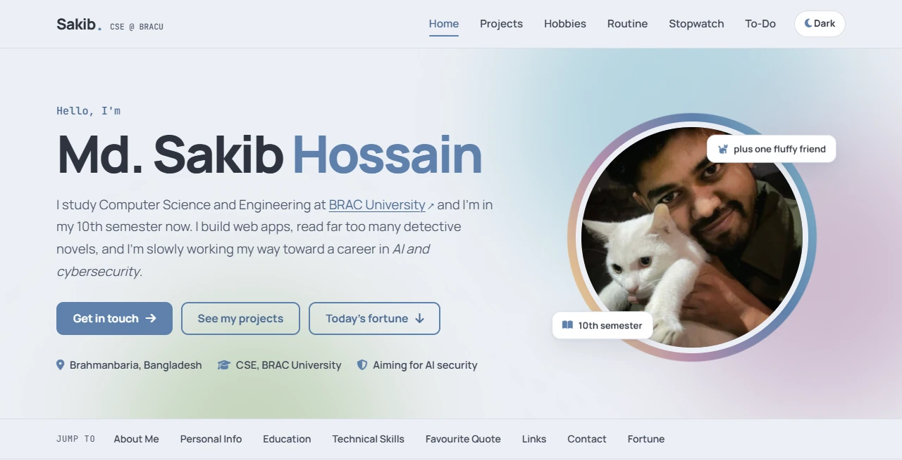
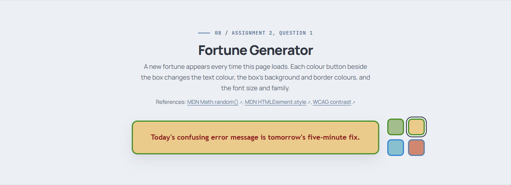
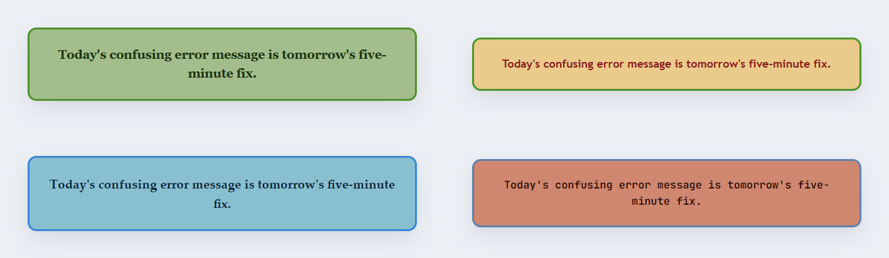
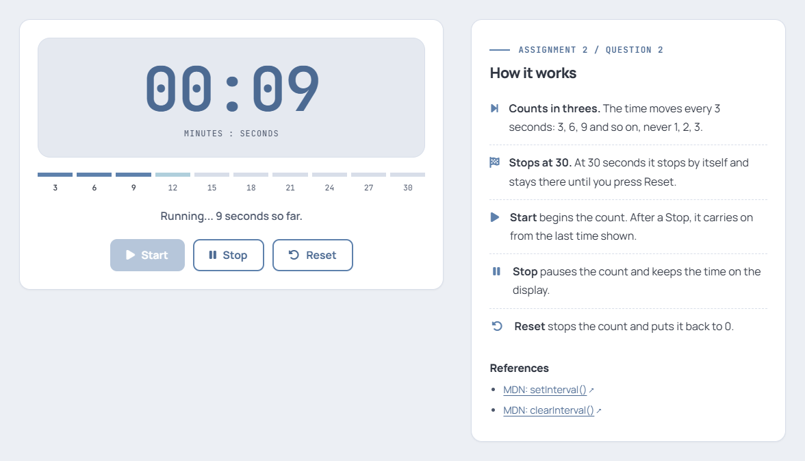
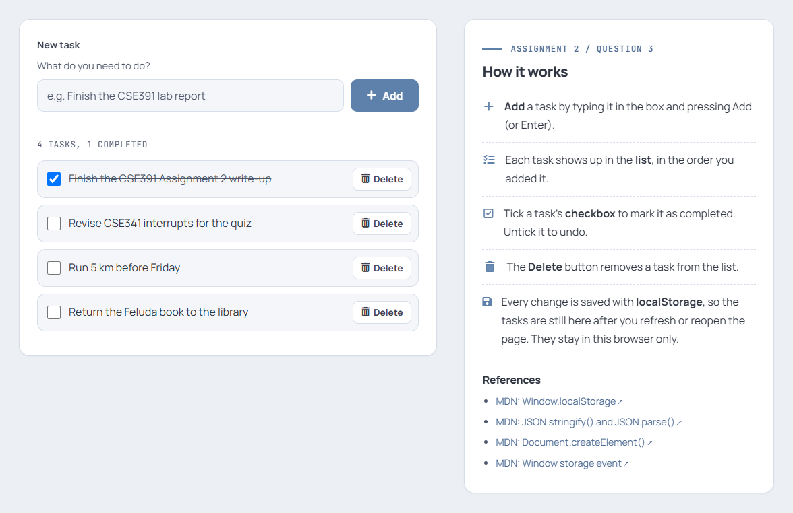

# CSE391: Programming for the Internet

My coursework hub for **CSE391 at BRAC University (Fall 2026)**: a personal homepage that also hosts every web app I build for the course. Assignments 1 and 2 are plain Strict XHTML 1.0, CSS and JavaScript; Assignment 3 adds PHP and MySQL. There are no frameworks and no build step.

**Live site:** https://sakibhossain0.github.io/cse391/

[](https://sakibhossain0.github.io/cse391/)
[](https://github.com/sakibhossain0/cse391/actions/workflows/pages/pages-build-deployment)


<picture>
  <source media="(prefers-color-scheme: dark)" srcset="docs/screenshots/home-dark.webp">
  
</picture>

## Contents

- [Assignments at a glance](#assignments-at-a-glance)
- [Assignment 1: Personal homepage](#assignment-1-personal-homepage)
- [Assignment 2: JavaScript apps](#assignment-2-javascript-apps)
- [Assignment 3: Car workshop appointment system](#assignment-3-car-workshop-appointment-system)
- [Project structure](#project-structure)
- [Run it locally](#run-it-locally)
- [Standards and validation](#standards-and-validation)
- [Accessibility](#accessibility)
- [Deployment](#deployment)
- [Credits and references](#credits-and-references)
- [About me](#about-me)

## Assignments at a glance

| # | Assignment | What it is | Try it | Status |
|---|---|---|---|---|
| 1 | Personal homepage | A four-page personal site with dark mode, a contact form and CSS animations | [Home page](https://sakibhossain0.github.io/cse391/) | Done |
| 2 | JavaScript programming | A fortune generator, a stopwatch and a to-do list | [Fortune](https://sakibhossain0.github.io/cse391/#fortune) · [Stopwatch](https://sakibhossain0.github.io/cse391/stopwatch.html) · [To-do list](https://sakibhossain0.github.io/cse391/todo.html) | Done |
| 3 | PHP and MySQL project | A car workshop appointment system with a user panel, an admin panel and help | Live link coming soon (it needs a PHP host) · [source](appointment/) | Built |
| | Labs and later assignments | Added here as I finish them | | Coming up |

## Assignment 1: Personal homepage

The homepage introduces me and links to everything else on the site.

| Page | What's on it |
|---|---|
| [Home](https://sakibhossain0.github.io/cse391/) (`index.html`) | About me, personal info, education, technical skills, a favourite quote, categorized links, a contact form and the fortune generator |
| [Projects](https://sakibhossain0.github.io/cse391/projects.html) (`projects.html`) | Notes on my projects, a live list of my GitHub repositories and my CSE391 work so far |
| [Hobbies](https://sakibhossain0.github.io/cse391/hobbies.html) (`hobbies.html`) | Books, writing, films and series, music, sports, clubs and things I build |
| [Routine](https://sakibhossain0.github.io/cse391/routine.html) (`routine.html`) | My Fall 2026 classes, the week at a glance and the exam schedule |

**Highlights**

- **Dark and light mode in pure CSS.** A hidden checkbox and the `~` sibling selector swap every colour. JavaScript only remembers your choice, and first-time visitors get their system theme.
- **Contact form.** Messages are sent through [FormSubmit](https://formsubmit.co/). If direct sending isn't available (for example when the page is opened from a local file), your email app opens with the message filled in.
- **Tables** on the routine page use merged rows and columns and striped rows, and scroll sideways on phones. Today's column is highlighted, and a line counts down to the next exam.
- **Live GitHub list** on the projects page, loaded from the GitHub REST API.
- **Footer** on every page shows the page's address and when it was last modified, filled in by JavaScript.
- **Animations:** a drifting aurora background, a spinning ring around my photo, floating tags, a typing cursor and scroll reveals. They all switch off if your system asks for reduced motion.

## Assignment 2: JavaScript apps

Three small apps in plain JavaScript that practise arrays, DOM manipulation, events, timers and `localStorage`.

### Question 1: Fortune generator

[Try it](https://sakibhossain0.github.io/cse391/#fortune) · `index.html` (the `#fortune` block) · [`js/fortune.js`](js/fortune.js)

- An array of 12 fortunes. Each time the home page loads, `Math.random()` picks one, and a reload never shows the same one twice in a row.
- The fortune sits in a centred box just above the footer of the home page.
- Four colour buttons sit beside the box. Each one applies a complete look: text colour, background colour, border colour, and a slightly different font size and font family.
- The colours were checked with the WCAG contrast formula. Text is at least 5.8:1 on every box, and the borders are at least 3.1:1 against both the light and the dark page.





### Question 2: Stopwatch

[Try it](https://sakibhossain0.github.io/cse391/stopwatch.html) · [`stopwatch.html`](stopwatch.html) · [`js/stopwatch.js`](js/stopwatch.js)

- Counts in steps of 3 seconds (3, 6, 9 and so on), using `setInterval` every 3000 ms.
- Stops by itself at 30 seconds and stays there until you press Reset.
- **Start** begins the count and **Stop** pauses it. Pressing **Start** again carries on from the last time shown, and **Reset** goes back to 0.
- Buttons that can't be used right now are disabled, keyboard focus moves to the next sensible button, and screen readers hear the time as it changes.



### Question 3: To-do list

[Try it](https://sakibhossain0.github.io/cse391/todo.html) · [`todo.html`](todo.html) · [`js/todo.js`](js/todo.js)

- Type a task and press **Add** (or Enter). An empty task shows an error instead of being added.
- Tasks appear in a list, each with a checkbox to mark it as completed and a **Delete** button.
- Every change is saved in `localStorage` as JSON, so the list is still there after a refresh or a browser restart. Two open tabs stay in sync through the `storage` event.
- Task text goes in with `textContent`, so typed HTML shows up as plain text. Corrupted saved data is ignored instead of breaking the page.



## Assignment 3: Car workshop appointment system

An online appointment system for a car workshop with 5 senior mechanics, each of whom takes at most 4 cars a day. Clients book the mechanic they want without visiting the workshop, and the workshop's admin manages the appointments. Built with HTML, CSS, JavaScript, PHP and MySQL.

Live link coming soon · source in [`appointment/`](appointment/)

### User panel ([`appointment/index.php`](appointment/index.php))

- The client enters their name, address, phone number, car license number, car engine number and appointment date, and picks a mechanic from the list.
- Every mechanic is listed with how many of their 4 places are free on the chosen date. The page asks the server again whenever the date changes, and after every booking.
- Picking a mechanic who is fully booked shows a warning under the list straight away.
- When the form is submitted, the server checks whether this client (the same phone number or the same car) already has an appointment that day, and whether the mechanic is already fully booked. It tells the client if either is true; otherwise it approves the appointment and shows a booking number.
- Each field is checked in the browser (JavaScript) and again on the server (PHP): every field is required, the phone and engine numbers must be digits only, the date must be a real date from today up to 60 days ahead, and a mechanic must be chosen.

### Admin panel ([`appointment/admin/`](appointment/admin/))

- Protected by a login (the live site's username and password are given to the course staff with the submission). It lists the appointments with the client's name, phone number, car registration number, appointment date and mechanic, and can filter them by date, mechanic or a search.
- **Change** moves an appointment to another date and/or another mechanic. Only mechanics with a free place that day can be picked. **Cancel** deletes an appointment.

### Help ([`appointment/help.php`](appointment/help.php))

Booking in 4 steps, what to type in each field, the workshop's rules, what each message means, answers to common questions, and help for the admin. Every field on the booking form also has a hint under it.

### How the rules are enforced

- **The 4-cars-a-day limit** is checked inside a database transaction that locks the mechanic's row (`SELECT ... FOR UPDATE`), so two clients booking the last free place at the same moment can't both get it. In a test where 10 separate PHP processes booked the same mechanic at the same moment, exactly 4 were approved.
- **One appointment per client per day** is enforced twice: by the PHP check, and by two `UNIQUE` keys in the database (phone + date, and car + date). Number plates are compared without their spaces and hyphens, so the same car typed differently still counts.
- **Privacy:** the page only ever asks the server for free places. Whether a client already has an appointment is checked only when they press Book, so nobody can look up someone else's bookings.
- **Security basics:** every SQL query uses prepared statements, everything shown on a page is escaped, every form carries a CSRF token, and the admin password is stored only as a hash. The session cookie is `httponly` and `SameSite=Lax`, PHP refuses session ids it didn't create, and the pages can't be shown inside another site's frame.

### Files

```text
appointment/
├── index.php             User panel: the booking form and the mechanics' free places
├── book.php              Receives a booking and applies the rules (JSON for JavaScript)
├── availability.php      Each mechanic's free places on a date (JSON)
├── help.php              Help page
├── admin/
│   ├── index.php         Login, then the appointment list with filters
│   ├── edit.php          Change an appointment's date and mechanic
│   ├── delete.php        Cancel an appointment
│   └── logout.php        Log out
├── includes/
│   ├── bootstrap.php     Loads the settings, the session, the database and the helpers
│   ├── config.sample.php Settings template (copy it to config.php)
│   ├── db.php            The PDO connection to MySQL
│   ├── functions.php     Validation, free places, and booking, changing and cancelling
│   ├── header.php        Top of every page
│   └── footer.php        Bottom of every page
├── assets/
│   ├── css/style.css     The look (Nord colours, light and dark)
│   └── js/
│       ├── booking.js    Talks to the server at every step of booking
│       └── admin.js      Reloads free places on the Change page, confirms cancelling
└── database/
    ├── schema.sql        The tables and the 5 mechanics
    └── sample-data.sql   Optional demo appointments
```

### Run it on your computer

1. Install [XAMPP](https://www.apachefriends.org/) and start **MySQL** (and **Apache** if you want to serve it from `htdocs`).
2. In phpMyAdmin, create a database called `cse391_workshop`, then import `appointment/database/schema.sql` (and `sample-data.sql` for demo appointments).
3. Copy `appointment/includes/config.sample.php` to `config.php` in the same folder. Its database settings already match XAMPP.
4. Choose an admin password and make its hash with `C:\xampp\php\php.exe -r "echo password_hash('your-password', PASSWORD_DEFAULT);"`, then paste the result into `ADMIN_PASSWORD_HASH` in `config.php`. The sample comes with no password, so every copy of the site gets its own.
5. Copy the `appointment` folder into `C:\xampp\htdocs\` and open `http://localhost/appointment/`, or run `php -S localhost:8393 -t appointment` and open `http://localhost:8393/`.

The admin username is `admin`, with the password from step 4.

### Put it online

GitHub Pages only serves static files and can't run PHP, so this assignment needs a PHP and MySQL host, such as the free [InfinityFree](https://www.infinityfree.com/):

1. Create a free hosting account, then create a MySQL database in its control panel.
2. Open phpMyAdmin from the control panel and import `appointment/database/schema.sql` into that database (and `sample-data.sql` if you want demo appointments).
3. Make `appointment/includes/config.php` from `config.sample.php`, not from your local copy, so `APP_DEBUG` stays `false`. Enter the host's MySQL host name, database name, user name and password, and the hash of a new admin password that isn't used anywhere else.
4. Upload everything inside `appointment/` except the `database` folder (it's only needed for step 2) into the host's `htdocs` folder, using its file manager or FTP. Include `includes/.htaccess`.
5. Open your site's address and test a booking and the admin panel. Once the host's free SSL certificate is active, use the `https://` address.

## Project structure

```text
cse391/
├── index.html            Home page, including the fortune generator (A2 Q1)
├── projects.html         Projects and a live list of my GitHub repositories
├── hobbies.html          Books, writing, films, music, sports and clubs
├── routine.html          Fall 2026 class routine and exam schedule
├── stopwatch.html        Stopwatch (A2 Q2)
├── todo.html             To-do list (A2 Q3)
├── css/
│   ├── style.css         Shared styles: Nord colour tokens, dark mode, layout, animations
│   └── apps.css          Styles for the Assignment 2 apps
├── js/
│   ├── theme-init.js     Applies the saved theme before the page is drawn
│   ├── script.js         Shared features: theme toggle, menu, footer info, contact form,
│   │                     GitHub list and routine helpers
│   ├── fortune.js        Fortune generator (A2 Q1)
│   ├── stopwatch.js      Stopwatch (A2 Q2)
│   └── todo.js           To-do list (A2 Q3)
├── appointment/          Assignment 3: the PHP and MySQL appointment system (see above)
├── images/               My photo and the favicon
├── docs/
│   ├── AI_Declaration.txt    AI usage declaration for Assignment 1
│   └── screenshots/      Images used in this README
├── favicon.ico
└── .nojekyll             Tells GitHub Pages to serve the files as they are
```

## Run it locally

Assignments 1 and 2 need nothing installed and no build step. Clone the repo and serve the folder (for Assignment 3, see [Run it on your computer](#run-it-on-your-computer) above):

```bash
git clone https://github.com/sakibhossain0/cse391.git
cd cse391
python -m http.server 8000
```

Then open `http://localhost:8000` in your browser. You can also open `index.html` straight from the folder. Everything works that way except direct sending from the contact form, which opens your email app instead.

## Standards and validation

- **Markup:** every page of Assignments 1 and 2 is Strict XHTML 1.0. That standard doesn't allow HTML5-only attributes such as `placeholder` and `aria-*`, so JavaScript adds them when the page loads and the markup stays valid. Assignment 3 uses HTML5.
- **Validation** (last checked on 2 November 2026 for Assignments 1 and 2, and on 10 November 2026 for Assignment 3):
  - [W3C Markup Validator](https://validator.w3.org/): all 6 pages of Assignments 1 and 2 pass with 0 errors and 0 warnings. The 5 Assignment 3 pages (booking, help, admin login, appointment list, change page) pass the [Nu HTML Checker](https://validator.w3.org/nu/) with 0 errors and 0 warnings.
  - [W3C CSS Validator](https://jigsaw.w3.org/css-validator/): all three stylesheets pass with 0 errors.
  - On Assignments 1 and 2, each page's footer has badges that link to both validators.
- **Assignment 3 tests:** 52 end-to-end checks of every booking rule, validation message, security setting and admin action against a local server, plus a race test in which 10 separate PHP processes book the same mechanic at the same moment (exactly 4 are approved).
- **JavaScript:** ES5 syntax (`var` and plain functions) with no libraries. Each script is wrapped in its own function so nothing leaks into the global scope. The larger scripts are split into numbered, commented sections and check that their page elements exist before running.

## Accessibility

- A skip link, visible keyboard focus and labelled form fields
- Screen-reader announcements for the stopwatch status, the to-do count and form errors
- App colours checked against WCAG contrast (text meets level AA)
- Animations switch off when your system asks for reduced motion
- A responsive layout for phones, tablets and desktops, in light and dark mode

## Deployment

GitHub Pages serves Assignments 1 and 2 from the root of the `main` branch. Every push to `main` republishes them within about a minute, through GitHub's built-in `pages-build-deployment` workflow. Assignment 3 needs PHP, so it runs on a separate PHP host (see [Put it online](#put-it-online)).

## Credits and references

**Libraries and services**

- [Font Awesome 6](https://fontawesome.com/) icons and [Google Fonts](https://fonts.google.com/) (Manrope, JetBrains Mono and Lora)
- The [Nord](https://www.nordtheme.com/docs/colors-and-palettes) colour palette
- [FormSubmit](https://formsubmit.co/) for the contact form
- The [GitHub REST API](https://docs.github.com/en/rest) for the live repository list
- [Shields.io](https://shields.io/) badges, and the BRAC University logo from [Wikimedia Commons](https://commons.wikimedia.org/)

**Documentation used for Assignment 2**

- MDN: [Math.random()](https://developer.mozilla.org/en-US/docs/Web/JavaScript/Reference/Global_Objects/Math/random), [HTMLElement.style](https://developer.mozilla.org/en-US/docs/Web/API/HTMLElement/style), [Window.sessionStorage](https://developer.mozilla.org/en-US/docs/Web/API/Window/sessionStorage)
- MDN: [setInterval()](https://developer.mozilla.org/en-US/docs/Web/API/Window/setInterval), [clearInterval()](https://developer.mozilla.org/en-US/docs/Web/API/Window/clearInterval)
- MDN: [Window.localStorage](https://developer.mozilla.org/en-US/docs/Web/API/Window/localStorage), [JSON](https://developer.mozilla.org/en-US/docs/Web/JavaScript/Reference/Global_Objects/JSON), [Document.createElement()](https://developer.mozilla.org/en-US/docs/Web/API/Document/createElement), [Window: storage event](https://developer.mozilla.org/en-US/docs/Web/API/Window/storage_event)
- MDN: [EventTarget.addEventListener()](https://developer.mozilla.org/en-US/docs/Web/API/EventTarget/addEventListener), [Event.preventDefault()](https://developer.mozilla.org/en-US/docs/Web/API/Event/preventDefault)
- W3C: [WCAG 2.1 contrast (minimum)](https://www.w3.org/WAI/WCAG21/Understanding/contrast-minimum.html)

**Documentation used for Assignment 3**

- PHP manual: [PDO](https://www.php.net/manual/en/book.pdo.php), [prepared statements](https://www.php.net/manual/en/pdo.prepared-statements.php), [transactions](https://www.php.net/manual/en/pdo.transactions.php), [password_hash()](https://www.php.net/manual/en/function.password-hash.php), [sessions](https://www.php.net/manual/en/book.session.php)
- MariaDB: [SELECT ... FOR UPDATE](https://mariadb.com/kb/en/for-update/), [unique keys](https://mariadb.com/kb/en/getting-started-with-indexes/#unique-index)
- MDN: [fetch()](https://developer.mozilla.org/en-US/docs/Web/API/Fetch_API/Using_Fetch), [FormData](https://developer.mozilla.org/en-US/docs/Web/API/FormData), [&lt;input type="date"&gt;](https://developer.mozilla.org/en-US/docs/Web/HTML/Element/input/date)
- OWASP: [Cross-Site Request Forgery prevention](https://cheatsheetseries.owasp.org/cheatsheets/Cross-Site_Request_Forgery_Prevention_Cheat_Sheet.html)

## About me

**Md. Sakib Hossain**, a 10th-semester Computer Science and Engineering student at BRAC University, working toward a career in AI and cybersecurity.

- GitHub: [sakibhossain0](https://github.com/sakibhossain0)
- LinkedIn: [Sakib Hossain](https://www.linkedin.com/in/sakib-hossain-7829b12a5)
- Email: md.sakib.hossain2@g.bracu.ac.bd

---

This repository is my coursework for CSE391. If you're taking the course too, feel free to look around for ideas, but please don't submit it as your own.
